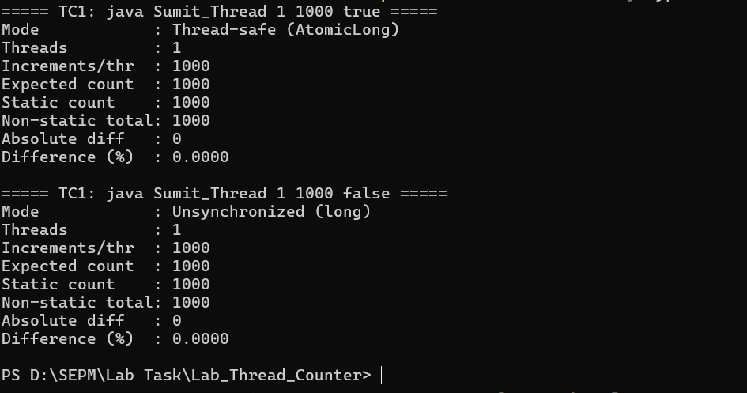
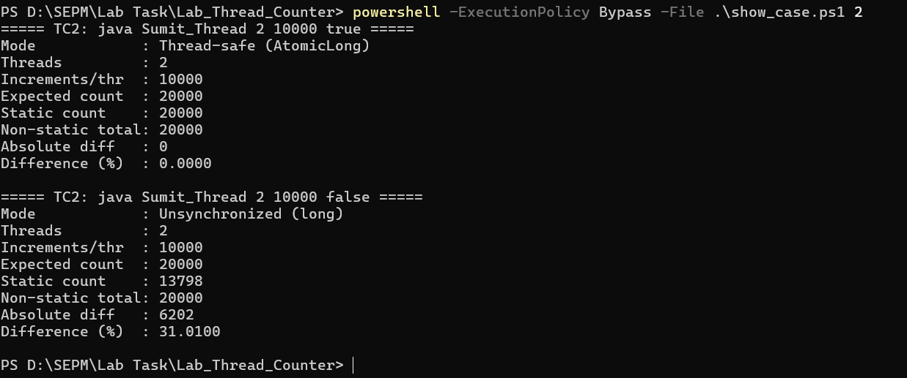
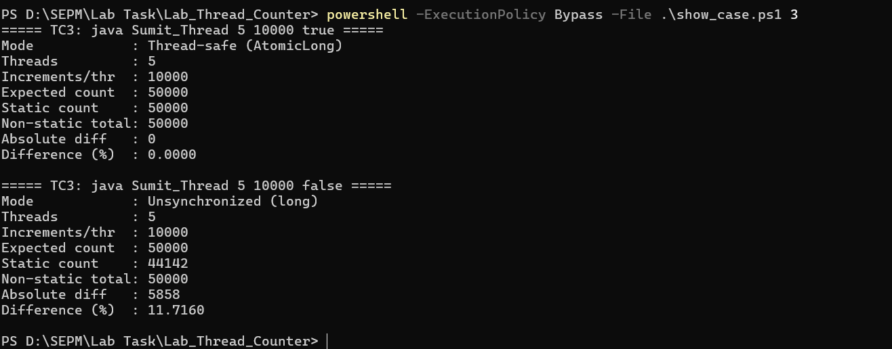
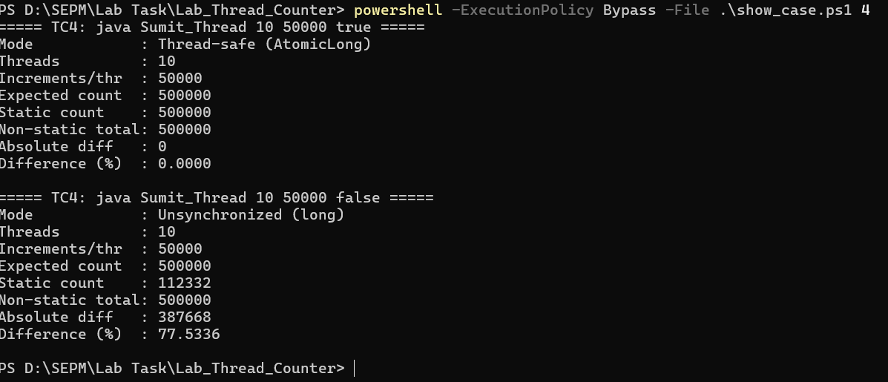
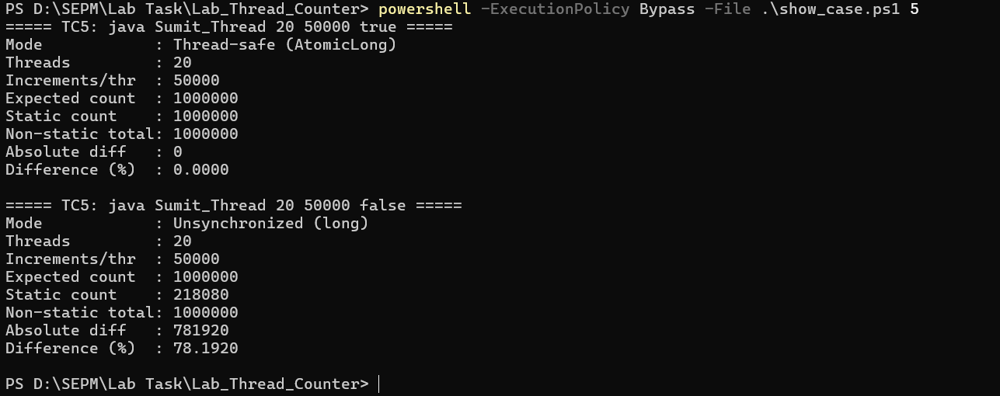
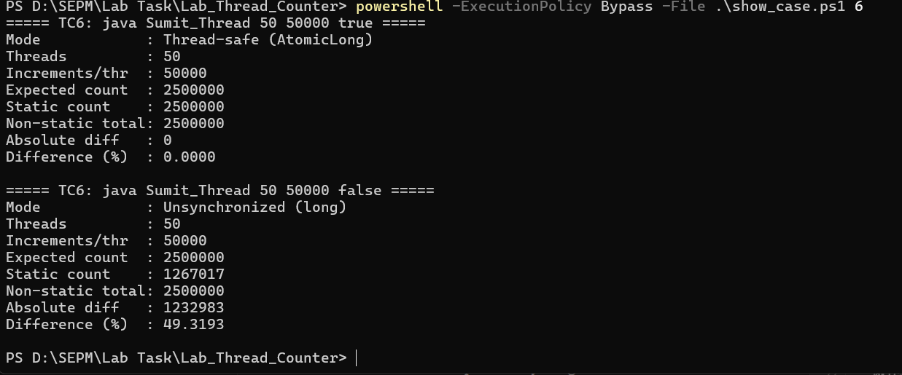
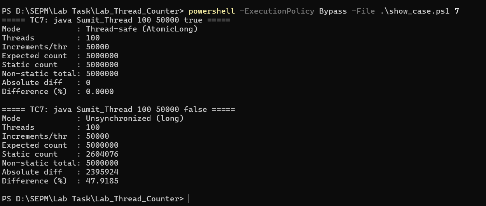

# Lab_Thread_Counter — Static vs Non-Static Counter in Multithreading

**Name:** Ridhikanta Sarkar Sumit | **ID:** IT24045 | **Course:** SEPM-001

## 1. Files

- `Sumit_Thread.java` – typed version used for running
- `handwritten/` – photo/scan of the handwritten code
- `outputs/` – screenshots (`TC1.png` … `TC7.png`), `output.txt`, `results.csv`, `tables.md`
- `run_all.ps1` – runs all test cases (1 safe + 5 unsynchronized runs each)
- `show_case.ps1` – prints one test case (used for the screenshots)
- `make_tables.ps1` – builds the result tables from `results.csv`

## 2. How to run

```bash
javac Sumit_Thread.java
java Sumit_Thread 10 100000 true    # thread-safe (AtomicLong)
java Sumit_Thread 10 100000 false   # unsynchronized
```

## 3. Test inputs

| Test | Threads | Increments/thread | Expected |
| --- | --- | --- | --- |
| TC1 | 1 | 1,000 | 1,000 |
| TC2 | 2 | 10,000 | 20,000 |
| TC3 | 5 | 10,000 | 50,000 |
| TC4 | 10 | 50,000 | 500,000 |
| TC5 | 20 | 50,000 | 1,000,000 |
| TC6 | 50 | 50,000 | 2,500,000 |
| TC7 | 100 | 50,000 | 5,000,000 |

## 4. Output screenshots









## 5. Result analysis

### Thread-safe (AtomicLong)

| Threads | Increments/thread | Expected | Static | Non-static | Abs diff | Diff % |
| --- | --- | --- | --- | --- | --- | --- |
| 1 | 1,000 | 1,000 | 1,000 | 1,000 | 0 | 0.00 |
| 2 | 10,000 | 20,000 | 20,000 | 20,000 | 0 | 0.00 |
| 5 | 10,000 | 50,000 | 50,000 | 50,000 | 0 | 0.00 |
| 10 | 50,000 | 500,000 | 500,000 | 500,000 | 0 | 0.00 |
| 20 | 50,000 | 1,000,000 | 1,000,000 | 1,000,000 | 0 | 0.00 |
| 50 | 50,000 | 2,500,000 | 2,500,000 | 2,500,000 | 0 | 0.00 |
| 100 | 50,000 | 5,000,000 | 5,000,000 | 5,000,000 | 0 | 0.00 |

### Unsynchronized (5 runs each)

| Threads | Run | Expected | Static (unsafe) | Non-static | Abs diff | Diff % |
| --- | --- | --- | --- | --- | --- | --- |
| 1 | 1 | 1,000 | 1,000 | 1,000 | 0 | 0.00 |
| 1 | 2 | 1,000 | 1,000 | 1,000 | 0 | 0.00 |
| 1 | 3 | 1,000 | 1,000 | 1,000 | 0 | 0.00 |
| 1 | 4 | 1,000 | 1,000 | 1,000 | 0 | 0.00 |
| 1 | 5 | 1,000 | 1,000 | 1,000 | 0 | 0.00 |
| 2 | 1 | 20,000 | 13,347 | 20,000 | 6,653 | 33.27 |
| 2 | 2 | 20,000 | 11,981 | 20,000 | 8,019 | 40.10 |
| 2 | 3 | 20,000 | 11,960 | 20,000 | 8,040 | 40.20 |
| 2 | 4 | 20,000 | 12,615 | 20,000 | 7,385 | 36.93 |
| 2 | 5 | 20,000 | 17,950 | 20,000 | 2,050 | 10.25 |
| 5 | 1 | 50,000 | 46,611 | 50,000 | 3,389 | 6.78 |
| 5 | 2 | 50,000 | 45,048 | 50,000 | 4,952 | 9.90 |
| 5 | 3 | 50,000 | 43,768 | 50,000 | 6,232 | 12.46 |
| 5 | 4 | 50,000 | 42,541 | 50,000 | 7,459 | 14.92 |
| 5 | 5 | 50,000 | 45,923 | 50,000 | 4,077 | 8.15 |
| 10 | 1 | 500,000 | 125,363 | 500,000 | 374,637 | 74.93 |
| 10 | 2 | 500,000 | 110,842 | 500,000 | 389,158 | 77.83 |
| 10 | 3 | 500,000 | 65,868 | 500,000 | 434,132 | 86.83 |
| 10 | 4 | 500,000 | 58,279 | 500,000 | 441,721 | 88.34 |
| 10 | 5 | 500,000 | 259,159 | 500,000 | 240,841 | 48.17 |
| 20 | 1 | 1,000,000 | 188,974 | 1,000,000 | 811,026 | 81.10 |
| 20 | 2 | 1,000,000 | 155,059 | 1,000,000 | 844,941 | 84.49 |
| 20 | 3 | 1,000,000 | 122,894 | 1,000,000 | 877,106 | 87.71 |
| 20 | 4 | 1,000,000 | 133,289 | 1,000,000 | 866,711 | 86.67 |
| 20 | 5 | 1,000,000 | 262,203 | 1,000,000 | 737,797 | 73.78 |
| 50 | 1 | 2,500,000 | 387,932 | 2,500,000 | 2,112,068 | 84.48 |
| 50 | 2 | 2,500,000 | 192,702 | 2,500,000 | 2,307,298 | 92.29 |
| 50 | 3 | 2,500,000 | 266,336 | 2,500,000 | 2,233,664 | 89.35 |
| 50 | 4 | 2,500,000 | 2,143,582 | 2,500,000 | 356,418 | 14.26 |
| 50 | 5 | 2,500,000 | 1,384,918 | 2,500,000 | 1,115,082 | 44.60 |
| 100 | 1 | 5,000,000 | 1,893,613 | 5,000,000 | 3,106,387 | 62.13 |
| 100 | 2 | 5,000,000 | 4,552,192 | 5,000,000 | 447,808 | 8.96 |
| 100 | 3 | 5,000,000 | 3,769,528 | 5,000,000 | 1,230,472 | 24.61 |
| 100 | 4 | 5,000,000 | 1,691,758 | 5,000,000 | 3,308,242 | 66.16 |
| 100 | 5 | 5,000,000 | 1,850,139 | 5,000,000 | 3,149,861 | 63.00 |

### Average of 5 unsynchronized runs

| Threads | Avg static | Avg abs diff | Avg Diff % | Min % | Max % |
| --- | --- | --- | --- | --- | --- |
| 1 | 1,000 | 0 | 0.00 | 0.00 | 0.00 |
| 2 | 13,571 | 6,429 | 32.15 | 10.25 | 40.20 |
| 5 | 44,778 | 5,222 | 10.44 | 6.78 | 14.92 |
| 10 | 123,902 | 376,098 | 75.22 | 48.17 | 88.34 |
| 20 | 172,484 | 827,516 | 82.75 | 73.78 | 87.71 |
| 50 | 875,094 | 1,624,906 | 65.00 | 14.26 | 92.29 |
| 100 | 2,751,446 | 2,248,554 | 44.97 | 8.96 | 66.16 |


## 6. Observation & Conclusion

## 6. Observation & Conclusion

### Observations

**Thread-safe experiment (AtomicLong).** In all seven test cases (1 to 100 threads) the static counter equaled the non-static total exactly. The absolute difference was 0 and the percentage difference was 0.00%. This is the control case. It shows the program counts correctly when the shared counter is updated atomically.

**Unsynchronized experiment (regular `long`).** The non-static total was always exactly correct, because each thread increments its own private counter. The static counter was lower than expected in every run with 2 or more threads, so increments were lost. With 1 thread there was no loss in any run.

| Threads | Avg difference (%) | Min (%) | Max (%) | Avg absolute difference |
| --- | --- | --- | --- | --- |
| 1 | 0.00 | 0.00 | 0.00 | 0 |
| 2 | 32.15 | 10.25 | 40.20 | 6,429 |
| 5 | 10.44 | 6.78 | 14.92 | 5,222 |
| 10 | 75.22 | 48.17 | 88.34 | 376,098 |
| 20 | 82.75 | 73.78 | 87.71 | 827,516 |
| 50 | 65.00 | 14.26 | 92.29 | 1,624,906 |
| 100 | 44.97 | 8.96 | 66.16 | 2,248,554 |

- **1 thread:** 0% loss in every run. Only one thread touches the counter, so no race is possible.
- **2 and 5 threads:** the average difference was 32.15% at 2 threads and then dropped to 10.44% at 5 threads, even though 5 threads is more concurrency. A likely reason is that these test cases use only 10,000 increments per thread, so each thread finishes very quickly. A thread can complete most or all of its work before the next one starts, so little overlap happens. I did not measure this, so it is a probable explanation, not a proven one.
- **10 and 20 threads:** the average difference jumped to 75.22% and 82.75%, the highest in the experiment. These cases use 50,000 increments per thread, so threads run long enough to overlap heavily, and most updates overwrite each other.
- **50 and 100 threads:** the average fell to 65.00% and 44.97%, although the absolute number of lost increments kept growing (about 1.62 million at 50 threads and 2.25 million at 100). The expected total grows faster than the number of lost updates, so the percentage drops. Threads also start one after another, so with many threads the early ones may finish before the later ones begin, which reduces the overlap.
- **Variation between runs:** results with the same inputs differed a lot. At 50 threads the difference ranged from 14.26% to 92.29%. At 100 threads it ranged from 8.96% to 66.16%. At 10 threads it ranged from 48.17% to 88.34%. The OS and JVM schedule threads differently on every run, so the number of lost updates is not repeatable.

### Why this happens

`count++` on a regular `long` is not one operation. It is three steps: read the value, add 1, write it back. If two threads read the same value before either writes, both write the same result and one increment is lost. This is a race condition. `AtomicLong.incrementAndGet()` performs the whole update as one indivisible operation (using compare-and-set), so no update is lost. The non-static counter is never shared, so it needs no protection.

### Conclusion

- `static` versus non-static describes **ownership** (one copy for the class versus one copy per object). It does not make a variable thread-safe.
- A shared static counter needs synchronization or atomic operations. Without them, concurrent updates are lost.
- More threads can cause lost updates, but the percentage difference does **not** increase steadily with thread count. In my runs it was 32.15% at 2 threads, fell to 10.44% at 5, peaked at 82.75% at 20, and fell again to 44.97% at 100.
- The result depends on thread scheduling, how long each thread runs, hardware, and runtime conditions, so individual runs vary widely.
- The thread-safe experiment gave 0% difference in every case, as expected.
### Why this happens

`count++` on a regular `long` is three steps: read, add 1, write back. If two
threads read the same value before either writes, one increment is lost (a race
condition). `AtomicLong.incrementAndGet()` does the whole update as one
indivisible operation, so nothing is lost. The non-static counter belongs to a
single thread's object, so it is never contended.

### Conclusion

- `static` vs non-static describes ownership, not thread safety.
- A shared static counter needs synchronization or atomic operations.
- Lost updates appear with concurrency, but the percentage difference is not
  guaranteed to grow steadily with thread count.
- The thread-safe experiment is the control case: 0% difference.

## 7. Analysis questions (answers)

1. A static variable belongs to the class and has one copy shared by all objects. A non-static variable belongs to each object, which has its own copy.
2. There is only one copy of a static variable, stored with the class, so every thread reads and writes the same memory.
3. Each thread runs its own object, and each object has its own instance field that no other thread touches.
4. `start()` returns immediately. `join()` makes `main` wait until every thread finishes, so the totals are final when read.
5. `count++` is read, add, write. Two threads can read the same value and write back the same result, so one increment is lost.
6. No. Loss depends on scheduling, core count, and runtime behavior, so the trend is not guaranteed to be monotonic. (Support this with your own data.)
7. The OS and JVM schedule threads differently on each run, so the number of collisions differs.
8. `AtomicLong` performs each increment as a single atomic operation (compare-and-set), so no updates are lost.
9. Create one object and pass that same object to every `Thread`, so they share its instance counter. Make that counter an `AtomicLong` or protect it with `synchronized`.
